# Architecture

This diagram describes the original offline research pipeline, whose federated path is a single-process simulation. The added `fedcontext.network` package also implements separate RSU/server processes with HTTP(S) parameter exchange; see `NETWORK_FEDERATION.md`. Network mode uses fixed rounds and separate offline calibration.

```mermaid
flowchart TD
    A["VeReMi receiver logs"] --> B["Validate labels, splits and provenance"]
    B --> C["Causal features and windows"]
    C --> D["Benign virtual-RSU training partitions"]
    D --> E["Movement GRU"]
    D --> F["Timing GRU autoencoder"]
    D --> G["Context MLP autoencoder"]
    E --> H["FedAvg global parameters"]
    F --> H
    G --> H
    H --> I["Local inference and stream errors"]
    J["Separate benign calibration partitions"] --> K["Ranks and two thresholds"]
    I --> K
    K --> L["Trusted / Uncertain / Suspicious"]
    L --> M["Held-out evaluation and exports"]
```

Centralized training is a separate comparison path using the same benign windows and the same model architecture. Test labels are used only after scoring for evaluation. Model selection, score normalization and threshold choice use distinct benign validation receiver groups.

## Suggested team ownership

Person 1: dataset manifest/importer, leakage checks, movement features and predictor.

Person 2: timing features, timing autoencoder, replay/delay/flooding experiments.

Person 3: causal neighbour context, optional map adapter, context autoencoder, congestion evaluation.

Person 4: FedAvg orchestration, calibration/fusion, baselines, result exports and reproducibility.

Everyone should run the tests and understand labels, train/test separation and uncertainty policies. The package is newly modularized; it does not claim that the old Person 1-only folder already contained all these modules.
